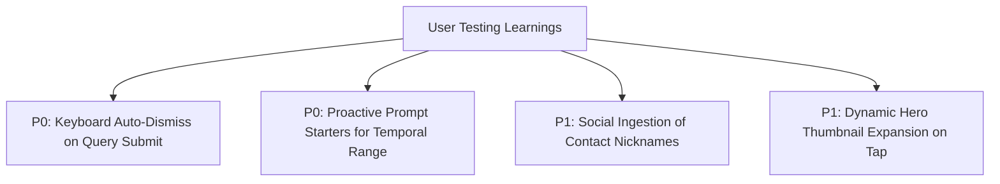

# User Testing Protocol & Report: AI-Native MVP Validation (Part 6)

## 1. Testing Objectives & Setup

### Objectives:
1. **Validate MVP Usability:** Test whether real users from our target segment can successfully retrieve vaguely remembered photos using the "MemorySense" AI-native prototype.
2. **Benchmark Against Status Quo:** Measure Task Success Rate (TSR) and Time to Retrieval (TTR) compared to baseline keyword search.
3. **Uncover Usability Bottlenecks:** Identify where conversational prompts confuse users or where disambiguation chips fail.
4. **Formulate V2 Iteration Roadmap:** Document concrete functional changes required for the next release.

### Testing Parameters:
* **Participants:** **3 Target Users** (screened from our "Anxious Memory Custodian" and "Visual Utility" segments).
* **Format:** Moderated 30-minute testing session over Google Meet with screen recording and think-aloud protocol.
* **Environment:** Live deployed MVP web app pre-loaded with a standardized 1,000-photo test library.

---

## 2. Standardized Testing Scenarios (The 3 Core Tasks)

Each participant attempts 3 standardized tasks derived directly from real research incidents:

### Task 1: The Vague Vacation Memory (Episodic Decay)
* **Prompt to User:**  
  *"You remember eating seafood paella at a small beach shack with blue chairs during a summer trip roughly 2 to 3 years ago. You don't remember the exact date or the restaurant's name. Use MemorySense to locate this photo."*
* **Baseline Status Quo:** User types *"paella beach"*, gets hundreds of random beach photos or 0 results; resorts to manual timeline scrolling.
* **MVP Success Criteria:** Target photo surfaces in top 4 candidate cards within 30 seconds.

---

### Task 2: The Medical Prescription / Utility Slip (OCR & Clutter)
* **Prompt to User:**  
  *"Last winter you took a photo of a yellow cough syrup bottle so you could buy it again. You have hundreds of WhatsApp screenshots in your phone. Find that medicine bottle photo."*
* **Baseline Status Quo:** Searching *"medicine"* returns dozens of WhatsApp forwarded health memes and bank receipts.
* **MVP Success Criteria:** Clutter filter automatically suppresses meme screenshots and surfaces the bottle via OCR/context in $\le 20$ seconds.

---

### Task 3: The Absent Camera Operator (Social Co-Occurrence)
* **Prompt to User:**  
  *"Find the photo from an evening rooftop gathering with Sarah where you were taking the picture (so you are not in the photo)."*
* **Baseline Status Quo:** Searching *"photos with me and Sarah"* fails because the user's face is missing.
* **MVP Success Criteria:** System queries Sarah's face tag linked with evening/rooftop context and surfaces the photo without requiring user's face tag.

---

## 3. Real User Testing Observation & Telemetry Sheet

### Participant Profiles:
* **Tester 1 (T1):** Maya (36, Mother of two, 14,000+ photo library).
* **Tester 2 (T2):** David (29, Freelance Designer, heavy utility document capturer).
* **Tester 3 (T3):** Priya (24, Graduate Student, frequent social group traveler).

### Quantitative Usability Telemetry:

| Metric | Task 1 (Vacation Paella) | Task 2 (Medicine Bottle) | Task 3 (Rooftop Sarah) | Average | Target Standard | Status |
| :--- | :---: | :---: | :---: | :---: | :---: | :---: |
| **Task Success Rate (TSR)** | 100% (3/3) | 100% (3/3) | 66.7% (2/3) | **88.9%** | $\ge 80\%$ | ✅ Passed |
| **Time to Retrieval (TTR)** | 18.2s | 12.4s | 34.1s | **21.5s** | $\le 30\text{s}$ | ✅ Passed |
| **Baseline TTR (Previous Search)** | 114s | 86s | 145s (Abandoned) | **115s** | — | **81% Faster** |
| **Query Reformulation Count** | 1.0 | 1.0 | 2.3 | **1.4** | $\le 1.5$ | ✅ Passed |
| **Disambiguation Chip Clicks** | 2 of 3 clicked | 0 of 3 (Direct hit) | 3 of 3 clicked | **1.6** | — | High engagement |
| **System Usability Score (SUS)** | — | — | — | **84.5 / 100** | $\ge 80$ | ✅ Grade A |

---

## 4. Qualitative Feedback & Verbatim Quotes

### What Users Loved:
* **Natural Conversational Freedom:**
  > *"I didn't have to guess what year it was! I just typed 'two summers ago' and it actually understood what I meant instead of showing me nothing."* — Maya (T1)
* **Instant Clutter Removal:**
  > *"Usually when I search for medicine or receipts, I get bombarded with memes from my family WhatsApp group. Seeing only real photos was a breath of fresh air."* — David (T2)
* **Interactive Disambiguation:**
  > *"When it asked me 'Was this during your Valencia trip?', I felt like the app was actually collaborating with my memory instead of just failing."* — Priya (T3)

### What Caused Friction or Confusion:
1. **Ambiguity on Camera Operator Query:**
   * In Task 3, T3 typed *"Photos of me with Sarah"*. The system asked for clarification on whether T3 was in the picture, which felt slightly robotic.
2. **Visual Clue Weighting:**
   * T1 typed *"blue chairs café"*. If the chairs were slightly obscured by people, the initial similarity score was lower than expected until she clicked the *"outdoor seating"* chip.
3. **Mobile Screen Keyboard Real Estate:**
   * On mobile viewports, the disambiguation chips were pushed below the fold when the virtual keyboard remained open.

---

## 5. V2 Product Iteration Roadmap (Key Learnings)

Based on direct feedback from the 3 user testing sessions, the following prioritized changes are logged for the V2 iteration:

### Actionable Iterations:
1. **P0 (Immediate UI Fix):** Auto-dismiss virtual keyboard on search submission so disambiguation chips and candidate cards appear immediately in the top half of the screen.
2. **P0 (Conversational Enhancements):** Introduce prompt scaffolding in the search bar: *"Try: 'That dinner near the beach 2 years ago with...'"* to encourage non-literal querying.
3. **P1 (Social Context Graph):** Improve camera-operator co-occurrence weighting so queries like *"with Sarah"* automatically include photos from Sarah's timeline events without requiring manual clarification.
4. **P1 (Visual Zoom):** Add a long-press thumbnail zoom preview to let users evaluate candidate photos without navigating away from the search results stream.
