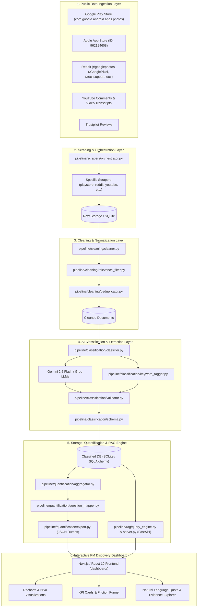
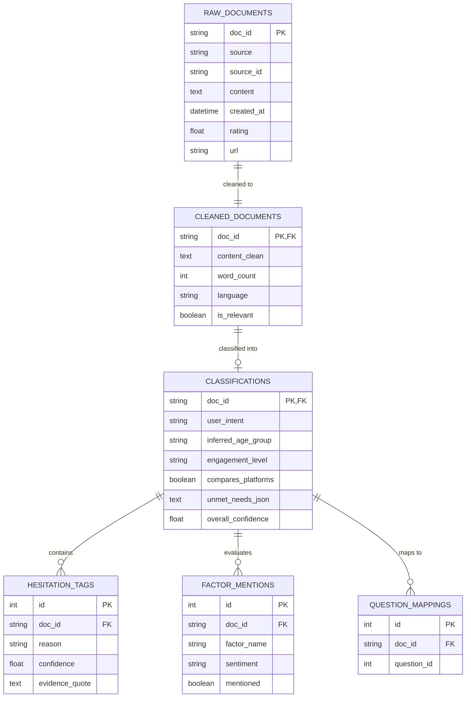

# Google Photos AI Discovery Engine — System Architecture

## 1. Executive Summary & Mission

The **Google Photos AI Discovery Engine** is an end-to-end intelligence system designed for the **Core Experience Product Management Team at Google Photos**. 

Its strategic goal is to:
> **Increase the percentage of users who successfully retrieve a photo they remember but cannot precisely describe when they start searching.**

Rather than optimizing generic keyword search, this engine captures, categorizes, and quantifies real user experiences at scale from public channels (Google Play Store, Apple App Store, Reddit, YouTube, Trustpilot). It identifies the cognitive and product breakdowns that occur when human episodic memory (emotions, vague visual cues, relative time) fails to match Google Photos' indexing mechanisms.

---

## 2. High-Level Architecture Diagram



---

## 3. End-to-End Data Pipeline Flow

The engine operates across 6 discrete stages:

```
Scrape  ──►  Clean  ──►  Classify (LLM)  ──►  Quantify  ──►  Index (RAG)  ──►  Dashboard
```

### Stage 1: Multi-Source Scraping
* **Target Sources:** Google Play Store, Apple App Store, Reddit, YouTube, Trustpilot.
* **Orchestration:** [orchestrator.py](file:///c:/Users/THARUN/Videos/AI%20DISCOVERY%20ENGINE%20GOOGLE%20PHOTOS/pipeline/scrapers/orchestrator.py) manages concurrent scraping, rate limits, pagination, and checkpointing.
* **Storage:** Raw text, timestamps, author metadata, ratings, and URLs are stored in `data/raw/` and SQLite.

### Stage 2: Cleaning, Relevance & Noise Filtering
* **Text Normalization:** Strips HTML, emojis, encoding artifacts, and bot-generated boilerplate.
* **Relevance Filter:** [relevance_filter.py](file:///c:/Users/THARUN/Videos/AI%20DISCOVERY%20ENGINE%20GOOGLE%20PHOTOS/pipeline/cleaning/relevance_filter.py) uses domain keywords (e.g., `google photos`, `search`, `cannot find`, `timeline`, `face`, `receipt`, `screenshot`) to drop unrelated noise.
* **Deduplication:** Hash-based and fuzzy deduplication prevents repeated cross-posts.

### Stage 3: AI Classification & Information Extraction
* **LLM Engine:** [classifier.py](file:///c:/Users/THARUN/Videos/AI%20DISCOVERY%20ENGINE%20GOOGLE%20PHOTOS/pipeline/classification/classifier.py) routes batches through LLMs (Gemini / Groq) or local fallback (Ollama).
* **Schema Validation:** [validator.py](file:///c:/Users/THARUN/Videos/AI%20DISCOVERY%20ENGINE%20GOOGLE%20PHOTOS/pipeline/classification/validator.py) enforces strict JSON matching [schema.py](file:///c:/Users/THARUN/Videos/AI%20DISCOVERY%20ENGINE%20GOOGLE%20PHOTOS/pipeline/classification/schema.py).
* **Information Extracted:**
  1. **Hesitation / Friction Reasons:** Specific root-cause tags with confidence score (0.0–1.0) and exact quote substring evidence.
  2. **User Intent:** Episodic memory search, utility/document retrieval, specific person search, casual browsing, or library cleanup.
  3. **User Demographics / Signals:** Power user vs. casual, inferred age segment, iOS vs. Android.
  4. **Competitor & Cross-Platform Behavior:** Mentions of Apple Photos, WhatsApp, OneDrive, etc.
  5. **Factor Mentions:** Sentiment towards OCR, facial recognition, search speed, clutter filtering, timeline navigation.
  6. **Unmet Needs:** Direct user quotes of features they wish Google Photos had.

### Stage 4: Quantification & Metrics Aggregation
* **SQL Aggregator:** [aggregator.py](file:///c:/Users/THARUN/Videos/AI%20DISCOVERY%20ENGINE%20GOOGLE%20PHOTOS/pipeline/quantification/aggregator.py) compiles statistical distributions:
  * Tag frequency percentages
  * Cross-tabulation by user segment and platform (Android vs. iOS)
  * Temporal trends across release cycles
  * Impact scores ($$\text{Impact} = \text{Frequency} \times \text{Confidence} \times \text{Severity}$$)
* **Question Mapping:** [question_mapper.py](file:///c:/Users/THARUN/Videos/AI%20DISCOVERY%20ENGINE%20GOOGLE%20PHOTOS/pipeline/quantification/question_mapper.py) aggregates metrics directly under the 10 Discovery Questions.
* **JSON Export:** [export.py](file:///c:/Users/THARUN/Videos/AI%20DISCOVERY%20ENGINE%20GOOGLE%20PHOTOS/pipeline/quantification/export.py) packages stats into `dashboard/public/data/` for zero-latency dashboard rendering.

### Stage 5: Semantic Search & RAG Service
* **FastAPI Server:** [server.py](file:///c:/Users/THARUN/Videos/AI%20DISCOVERY%20ENGINE%20GOOGLE%20PHOTOS/pipeline/rag/server.py) runs on port 8000.
* **Vector Store & Embedder:** [vector_store.py](file:///c:/Users/THARUN/Videos/AI%20DISCOVERY%20ENGINE%20GOOGLE%20PHOTOS/pipeline/rag/vector_store.py) and [embedder.py](file:///c:/Users/THARUN/Videos/AI%20DISCOVERY%20ENGINE%20GOOGLE%20PHOTOS/pipeline/rag/embedder.py) embed review snippets.
* **Natural Language Queries:** Allows PMs to ask natural questions (e.g. *"What do users say about searching for old vacation photos?"*) and retrieves grounded quotes with citations.

### Stage 6: Next.js Discovery Dashboard
* Built with Next.js App Router, Tailwind/Vanilla CSS, Recharts, and Nivo.
* Displays macro KPI cards, friction breakdowns, Sankey flow diagrams of user workarounds, and deep-dive question tabs.

---

## 4. Key Components & File Directory Reference

| Component | Key File | Responsibility |
| :--- | :--- | :--- |
| **Config Blueprint** | [discovery_config.yaml](file:///c:/Users/THARUN/Videos/AI%20DISCOVERY%20ENGINE%20GOOGLE%20PHOTOS/discovery_config.yaml) | Declarative single-source-of-truth for sources, 10 discovery questions, schema tags, and few-shot examples. |
| **Code Generator** | [setup_engine.py](file:///c:/Users/THARUN/Videos/AI%20DISCOVERY%20ENGINE%20GOOGLE%20PHOTOS/setup_engine.py) | Compiles `discovery_config.yaml` into scrapers, prompts, schemas, taggers, and dashboard constants. |
| **Scraper Suite** | [pipeline/scrapers/](file:///c:/Users/THARUN/Videos/AI%20DISCOVERY%20ENGINE%20GOOGLE%20PHOTOS/pipeline/scrapers/) | Modules for Play Store, App Store, Reddit, YouTube, and Trustpilot. |
| **Cleaning & Relevance** | [pipeline/cleaning/](file:///c:/Users/THARUN/Videos/AI%20DISCOVERY%20ENGINE%20GOOGLE%20PHOTOS/pipeline/cleaning/) | Regex sanitization, relevance keywords filter, and deduplication. |
| **Classification Engine** | [pipeline/classification/](file:///c:/Users/THARUN/Videos/AI%20DISCOVERY%20ENGINE%20GOOGLE%20PHOTOS/pipeline/classification/) | LLM batch processing, prompt templates, Pydantic validation, and keyword fallback. |
| **Database & ORM** | [pipeline/db/](file:///c:/Users/THARUN/Videos/AI%20DISCOVERY%20ENGINE%20GOOGLE%20PHOTOS/pipeline/db/) | SQLAlchemy models (`RawDocument`, `CleanedDocument`, `ClassificationRecord`, `HesitationTag`). |
| **Analytics & Export** | [pipeline/quantification/](file:///c:/Users/THARUN/Videos/AI%20DISCOVERY%20ENGINE%20GOOGLE%20PHOTOS/pipeline/quantification/) | Statistical aggregation, quote curation, and JSON compilation. |
| **RAG & Vector Search** | [pipeline/rag/](file:///c:/Users/THARUN/Videos/AI%20DISCOVERY%20ENGINE%20GOOGLE%20PHOTOS/pipeline/rag/) | FastAPI endpoint, semantic vector search, and grounded quote synthesis. |
| **Next.js Dashboard** | [dashboard/](file:///c:/Users/THARUN/Videos/AI%20DISCOVERY%20ENGINE%20GOOGLE%20PHOTOS/dashboard/) | Interactive UI with theme switching, metric breakdowns, and quote viewer. |

---

## 5. The 10 Strategic Discovery Questions Mapping

The engine categorizes reviews against a 10-question behavioral framework:

```
                     ┌─────────────────────────────────────────────────────────┐
                     │           Human Memory Encoding & Decay                 │
                     │  Q1: Struggled Photo Types    Q2: Retained Clues        │
                     │  Q3: Forgotten Metadata       Q4: Incomplete Queries    │
                     └──────────────────────────┬──────────────────────────────┘
                                                │
                                                ▼
                     ┌─────────────────────────────────────────────────────────┐
                     │          Product & Algorithmic Failure Points           │
                     │  Q5: Irrelevant Results & False Misses                  │
                     │  Q6: Endless Timeline Scrolling Fatigue                 │
                     │  Q7: Screenshot & Junk Clutter                          │
                     │  Q8: Face Recognition & People Tagging Failures         │
                     │  Q9: Text & Document (OCR) Search Failures              │
                     └──────────────────────────┬──────────────────────────────┘
                                                │
                                                ▼
                     ┌─────────────────────────────────────────────────────────┐
                     │             User Coping & Workarounds                   │
                     │  Q10: WhatsApp / Social Workarounds & Platform Switching│
                     └─────────────────────────────────────────────────────────┘
```

1. **Struggled Photo Types:** What kinds of old photos do users struggle to retrieve? *(Trips, receipts, medicine labels, candid moments)*
2. **Retained Memory Clues:** What information do people actually remember? *(Rough season/relative time, colors, companions, emotions)*
3. **Forgotten Metadata:** What information have they forgotten? *(Exact date, exact GPS location, filename, album)*
4. **Incomplete Query Formulation:** How do users formulate searches when memory is incomplete? *(Keyword guessing, literal search terms)*
5. **Irrelevant Results & False Misses:** Why does search return zero results or irrelevant photos for items known to exist?
6. **Endless Timeline Scrolling Fatigue:** Why do users succumb to scrolling through years of photos when search fails?
7. **Screenshot & Junk Clutter:** How do memes, receipts, and WhatsApp forwards drown out personal memories?
8. **Face Recognition Failures:** What causes People & Pets / face grouping search to fail or misidentify subjects?
9. **Text & Document (OCR) Search Failures:** Why does searching text inside images (prescriptions, signs, bills) fail?
10. **Workarounds & Platform Switching:** What external workarounds (WhatsApp media history, Apple Photos) do users use when Google Photos fails?

---

## 6. Data Model Architecture



---

## 7. Execution & Operational Workflow

### Step 1: Generate Code from Configuration
```bash
python setup_engine.py
```

### Step 2: Ingest & Process Pipeline
```bash
cd pipeline
# Initialize database schema
python run_pipeline.py --mode init-db

# Scrape sources
python run_pipeline.py --mode scrape --limit 100

# Clean & filter data
python run_pipeline.py --mode clean

# Classify using LLM & extract tags
python run_pipeline.py --mode classify

# Export aggregated metrics to dashboard
python run_pipeline.py --mode export
```

### Step 3: Run Interactive Services
```bash
# Terminal 1: Launch RAG service
cd pipeline
python run_pipeline.py --mode rag-server

# Terminal 2: Launch Insights Dashboard
cd ../dashboard
npm run dev
```
Accessible at: `http://localhost:3000`
