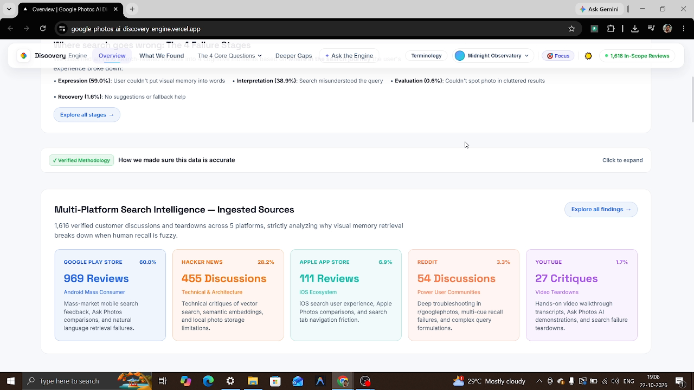

# Google Photos AI Discovery Engine

Analyzing visual memory retrieval friction in Google Photos — understanding how users recall past visual memories, where retrieval breaks down when memory is incomplete, and identifying opportunities for AI-native episodic retrieval.

## 🎬 Product Walkthrough & Demo

https://github.com/tkvp023/Google_photos_ai_discovery_engine/raw/B/demo.mp4

<div align="center">
  <video src="https://github.com/tkvp023/Google_photos_ai_discovery_engine/raw/B/demo.mp4" controls="controls" width="100%" style="border-radius: 8px;">
    Your browser does not support the video tag.
  </video>
</div>

[](https://github.com/tkvp023/Google_photos_ai_discovery_engine/raw/B/demo.mp4)

> 🚀 **Live Production Dashboard**: [google-photos-ai-discovery-engine.vercel.app](https://google-photos-ai-discovery-engine.vercel.app)  
> 📹 **Video Walkthrough**: 5-minute deep dive covering multi-platform search intelligence, the 4 retrieval failure stages, 10 discovery questions, and the AI RAG discovery engine.

## Architecture

```
Scrape → Clean → Classify (LLM) → Quantify → Dashboard
```

**Data Sources (Search-Only Retrieval Corpus — 1,616 Verified Documents)**:
- **Google Play Store**: 969 documents (60.0%)
- **Hacker News**: 455 documents (28.2%)
- **Apple App Store**: 111 documents (6.9%)
- **Reddit**: 54 documents (3.3%)
- **YouTube**: 27 documents (1.7%)

**Integrity & Scoping Standard**:
- **Collection-Level Scoping**: 100% search-based retrieval attempts by construction (classic keyword & Ask Photos/Gemini AI). Generic timeline scrolling, backup bugs, and app crashes strictly excluded.
- **100.0% Verifiable Substrings**: Every in-scope quote is an exact, character-for-character verifiable substring from raw review text (`INSTR > 0`).
- **7 Retrieval Flow Stages**: Intent (877) → Articulation (339) → Search (1,348) → Initial Results (593) → Scrolling Results (92) → Iterative Refinement (33) → Outcome (477).

## Quick Start

```bash
# 1. Install dependencies
pip install -r requirements.txt
cd dashboard && npm install && cd ..

# 2. Set up environment
cp .env.example .env
# Fill in your API keys

# 3. Run the pipeline
cd pipeline
python run_pipeline.py --mode full --limit 50

# 4. Start the dashboard
cd ../dashboard
npm run dev
```

## Discovery Questions

  1. **Struggled Photo Types** — What kinds of old photos do users struggle to retrieve?
  2. **Retained Memory Clues** — What information do people actually remember about a photo?
  3. **Forgotten Metadata** — What information have they forgotten?
  4. **Incomplete Query Formulation** — How do users formulate searches when their memory is incomplete?
  5. **Irrelevant Results & False Misses** — Why does search return completely irrelevant photos or say 'No results found' for photos users know are in their library?
  6. **Endless Timeline Scrolling** — Why do users complain about having to endlessly scroll through years of timeline photos when search fails them?
  7. **Screenshot & Junk Clutter** — How do screenshots, receipts, memes, and downloaded junk clutter and ruin search for personal memories?
  8. **Face Recognition Failures** — What specific failures do users report with People & Pets / facial recognition search?
  9. **Text & Document Search Failures** — Why does searching for text inside photos (receipts, prescriptions, documents, signs) fail for users?
  10. **Workarounds & Switching** — What workarounds do users resort to (e.g., searching WhatsApp chats, Apple Photos, asking friends) when Google Photos search fails?

## Pipeline Modes

| Mode | Command |
|------|---------|
| Initialize DB | `python run_pipeline.py --mode init-db` |
| Scrape data | `python run_pipeline.py --mode scrape --limit 100` |
| Clean data | `python run_pipeline.py --mode clean` |
| Classify (LLM) | `python run_pipeline.py --mode classify` |
| Export JSON | `python run_pipeline.py --mode export` |
| Full pipeline | `python run_pipeline.py --mode full` |
| RAG server | `python run_pipeline.py --mode rag-server` |
| Stats | `python run_pipeline.py --mode stats` |

## Tech Stack

- **Pipeline**: Python, SQLAlchemy, Pydantic, Gemini/Groq LLMs
- **Dashboard**: Next.js, Recharts, Nivo
- **Database**: SQLite
- **RAG**: FastAPI + scikit-learn vector store

---

*Generated by [AI Discovery Engine Template](https://github.com/your-repo)*
